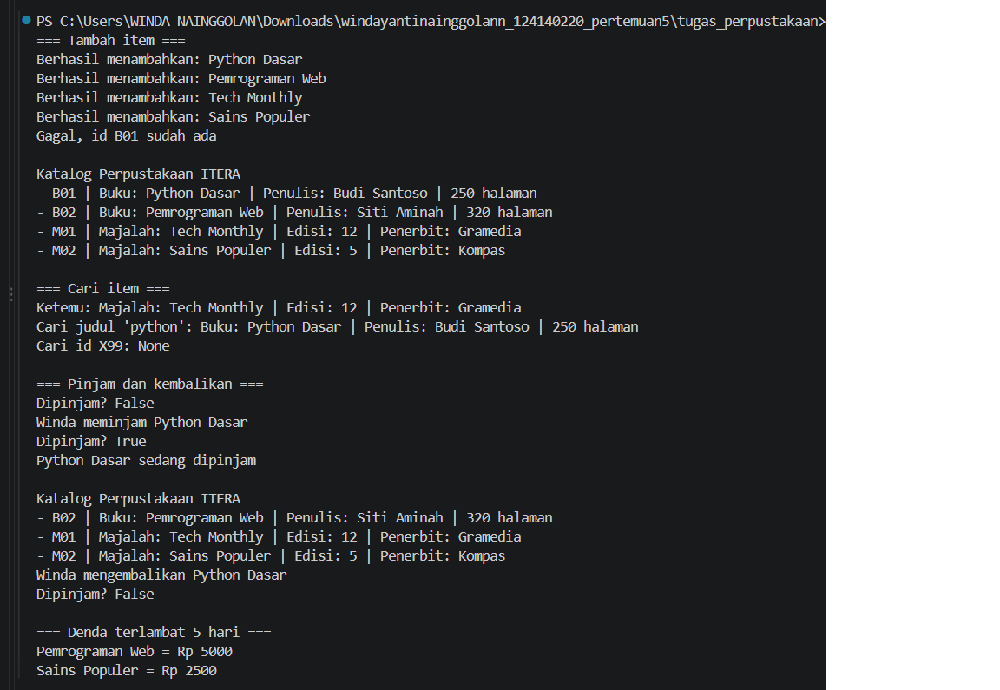

# Tugas Pertemuan 5 - Sistem Manajemen Perpustakaan Sederhana

## Identitas Mahasiswa
- **Nama Lengkap** : Winda Yanti Nainggolan
- **NIM** : 124140220
- **Kelas Praktikum** : ... *(isi RA / RB)*

## Deskripsi Program
Program ini adalah sistem perpustakaan sederhana berbasis OOP Python.

**Alur program** (`main.py`):
1. Membuat objek `Library` dan menambahkan beberapa `Book` dan `Magazine`.
2. Menampilkan katalog item yang tersedia.
3. Mencari item berdasarkan id dan judul.
4. Seorang `Member` meminjam dan mengembalikan item, lalu status ketersediaan diperlihatkan lewat katalog.
5. Mendemonstrasikan polymorphism (`hitung_denda`) dan encapsulation.

**Penerapan 4 pilar OOP:**

| Pilar | Penerapan |
|---|---|
| **Class** | `LibraryItem`, `Book`, `Magazine`, `Library`, `Member` memodelkan entitas perpustakaan. |
| **Inheritance** | `Book` dan `Magazine` mewarisi abstract class `LibraryItem(ABC)`. Method abstract `get_detail()` dan `hitung_denda()` wajib di-override. |
| **Encapsulation** | Atribut private (`__dipinjam`, `__penulis`, `__koleksi`) dan protected (`_item_id`, `_judul`). Akses lewat `@property` (mis. `is_dipinjam` bersifat read-only). |
| **Polymorphism** | `Library.tampilkan_katalog()` memanggil `get_detail()` pada semua item tanpa peduli jenisnya; `hitung_denda()` memberi hasil berbeda (Buku Rp1.000/hari, Majalah Rp500/hari). |

## Struktur Berkas
```
tugas_perpustakaan/
├── library_item.py   # LibraryItem (abstract), Book, Magazine
├── member.py         # Member
├── library.py        # Library
└── main.py           # Skrip pengujian
```

## Panduan Menjalankan Program
Membutuhkan Python 3.8+.
```bash
cd tugas_perpustakaan
python main.py
```

## Screenshot Output
